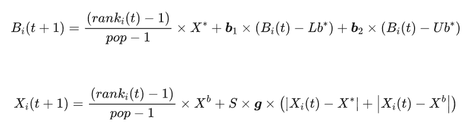
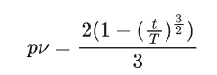
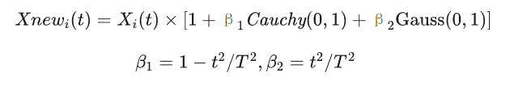
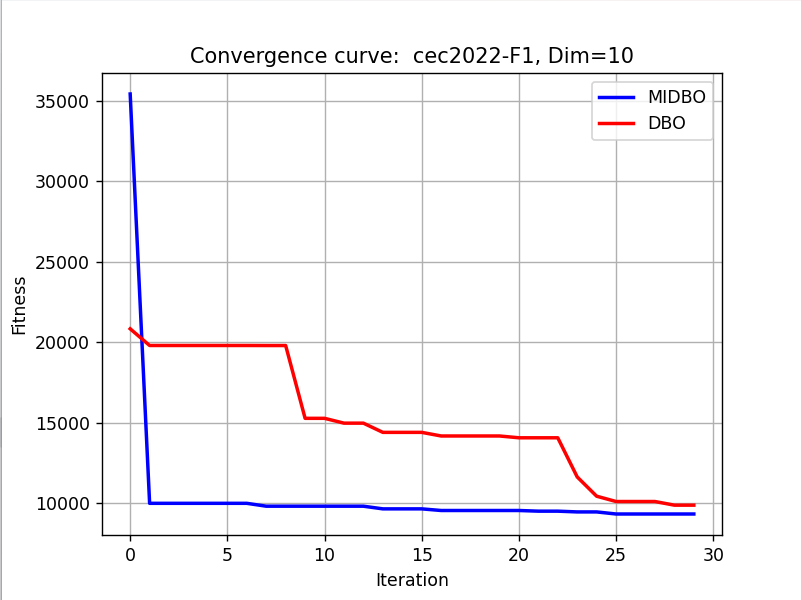
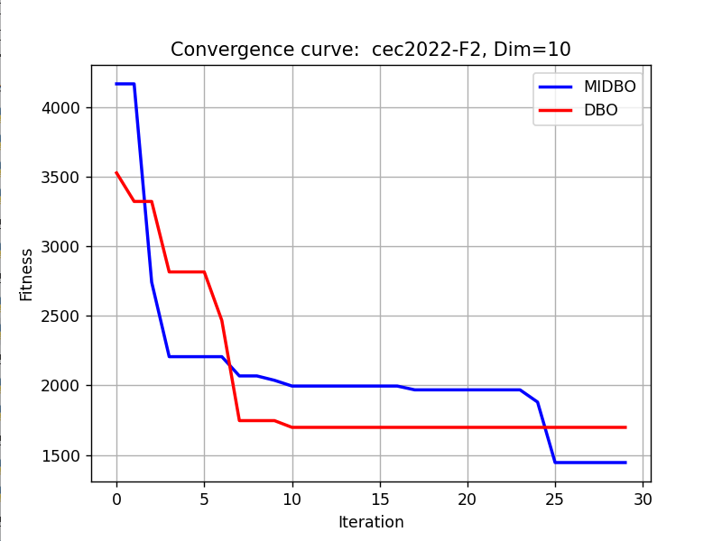

# Improved Dung Beetle Python Code(Optimal solution acceptance+Sparrow following mechanism+Cauchy-Gram variation)

This issue article reproduces a newly published paper titled "Multi-Strategy Improved Gyrella Optimization Algorithm and Its Application," which was published in the Chinese core journal "Computers Science and Exploration" on December 15, 2023. The references are as follows:
[1] Guo Qin, Zheng Qiaoxiang. Multi-Strategy Improved Gyrella Optimization Algorithm and Its Application [J/OL]. Computer Science and Exploration, 1-22 [2023-12-19]
The article abstract is as follows:
The Dung Beetle Optimizer (DBO) is a recently proposed intelligent optimization algorithm. Like other optimization algorithms, DBO has its limitations such as low convergence accuracy and tendency to fall into local optima. To address these limitations of DBO, a Multi-strategy Improved Dung Beetle Optimizer (MDBO) is proposed. Firstly, the acceptance degree of local and global optima by the chick ball and the thief beetle is improved, allowing them to dynamically adjust according to their search capabilities. This not only enhances the quality of the population but also maintains the good search capability of individuals with high adaptability.Secondly, Perturb the algorithm by incorporating a follower position update mechanism from the fusion of MAZE search algorithms. And update the position with greedy strategy. Improved the convergence accuracy of the algorithm; Finally, When the algorithm is stuck, introduce the Cauchy Gaussian mutation strategy. Enhanced the algorithm's ability to escape local optima.
The Dung Beetle Algorithm has attracted numerous scholars' research since its introduction and is a popular algorithm. The basic principle of the Dung Beetle Algorithm can be referred to: Intelligent Algorithms - Dung Beetle Optimization Algorithm(DBO), Detailed explanation of the principle formulas, with appendixmatlabCode  
The principle of the multi-strategy improved ant optimization algorithm is as follows:
Improvement strategy
Improvement point 1: Enhance the acceptance of optimal solutions by chick balls and kleptocysts.
In the basic ant optimization algorithm, The position update is based on the local optimal position. Stealing Dung Beetle also update their positions based on the global optimal position. From this, The chick ball and the scavenger beetle will constantly move towards the local optimal position and the global optimal position. However, in the early stages of the algorithm. The search scope of the group should be expanded as much as possible. Although it can make the algorithm converge quickly, However, there is a certain probability that it will cause the algorithm to be stuck. Causes the algorithm to fail to converge to a global optimum solution.
Therefore, a strategy is designed to dynamically adjust the acceptance of local and global optimal positions by both the larva balls and the scavenging cephalopods based on their search capabilities (fitness values). The specific method involves sorting the cephalopod population according to their search abilities (based on fitness values), and updating the positions of both the larva balls and the scavenging cephalopods as follows:
\n        \n  
Improvement point 2: Disturbance strategy integrated with the pursuit mechanism of the sparrow search algorithm
The Sparrow Algorithm has high accuracy of convergence. Fast convergence rate. Characterized by strong robustness, etc. In the aspect of function optimization problems, Superior to Particle Swarm Algorithm. Gray Wolf Optimization Algorithm and Other Particle Swarm Optimization Algorithms []. Therefore, The position update mechanism of followers in the squirrel optimization algorithm is introduced as a perturbation strategy. Define the discoverer's optimal position in the Sparrow Search Algorithm as the global optimal position in the Dung Beetle Optimization Algorithm. If the disturbance is too strong. Groups are prone to falling into a state of chaos and disorder. If the disturbance is too weak. The disturbance strategy will not be effective; Therefore, Adapt the perturbation probability according to the iteration depth. And adopts the greedy strategy to decide whether to retain this disturbance. The disturbance probability is shown in the formula:
\n        \n  
In the early iterations, the perturbation probability is high, allowing for the full exploitation of the squirrel-following mechanism's role in perturbation, thereby enhancing the quality of the population and improving the algorithm's optimization performance. In later iterations, the perturbation probability gradually decreases, accelerating the convergence speed of the algorithm. The specific perturbation steps are as follows: a) Calculate the perturbation probability pv for individual i according to the formula above; b) Generate a random number r∈(0,1), if r<pv, proceed to step c), otherwise, do not perturb individual i; c) Generate a random number r1∈(0,1), if r1<ST, generate a new solution according to the second formula in the squirrel algorithm, otherwise, generate a new solution according to the first formula. Extensive experiments have proven that ST=0.7 yields the best results.This means that 70% of the individuals in the group will migrate towards the optimal position of the group. 30% of individuals exhibit a greater degree of positional variance than themselves. (d) Calculate the fitness value of the new solution. If the fitness value is better than before perturbation. Use the new solution to replace the solution before perturbation. Otherwise, This disturbance is invalid.
Improvement point 3: Cauchy Gaussian mutation
The disturbance introduced by the Sparrow Search Algorithm's pursuit mechanism primarily serves to enable the population to thoroughly explore the solution space, enhancing the quality of the population, akin to chaotic perturbation. In cases of multiple peaks, the Dung Beetle Optimization Algorithm and other swarm intelligence optimization methods similarly tend to fall into local optima. The Cauchy Gaussian mutation is proposed as an auxiliary strategy to address this issue, increasing the probability that the algorithm will escape from local optima.[3], Improve the optimization accuracy of the algorithm. After each perturbation of the flock search algorithm's follow-me mechanism, determine whether the population is prematurely matured. The method for determining this is: If the population has passed...5The optimal solution remains unchanged after the second iteration, indicating that the algorithm has hit a dead-end (early saturation). To overcome this issue, apply the Cauchy Gaussian mutation strategy to the entire population, enabling it to escape from local optima. The Cauchy Gaussian mutation method is described by the following equation.:   
\n Required packages:
matplotlib~=3.8.2\nnumpy~=1.26.3\nscipy~=1.12.0\nopfunu~=1.0.1\nResults display  
Utilizing the powerful opfunu library in Python, it integrates 11 CEC function libraries such as CEC2005/2008/2010/2013.

## Images

<!-- PAYMENT_BLOCK -->

## Get this dataset

- Payment link (Stripe): [Buy now](https://buy.stripe.com/3cs8yP7sY87d0vu9AB)
- Payment QR code: 

<!-- /PAYMENT_BLOCK -->
